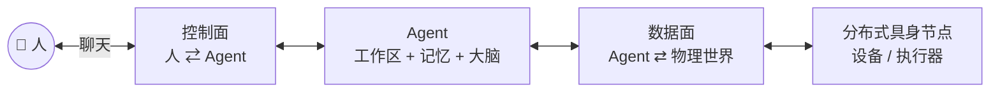

# Agent-Ops-Architecture

**分布式 Agent 编排规范：跨越数字与物理边界 —— 一个人，指挥一支 AI 团队，驱动无数物理节点。**

🔗 **三件套** · [🔭 总蓝图（本仓）](https://github.com/Ly-Systems-Lab/Agent-Ops-Architecture) · [🧠 控制面 · WeCom-Bridge](https://github.com/Ly-Systems-Lab/Agent-Ops-WeCom-Bridge) · [🔌 数据面 · Edge-Hub](https://github.com/Ly-Systems-Lab/Agent-Ops-Edge-Hub)

> 这是 **Agent Ops 三件套**里的「总蓝图」—— **只有文档，没有代码**。
>
> 它回答两个正在合并的问题：**当 AI 开始需要一具身体，这具身体该怎么接？**
> **当一个人手上有一支 Agent 团队和一堆设备，谁说了算、怎么留痕？**
>
> 我们的答案不是"把模型塞进设备"，而是**把大脑和躯体拆开** ——
> 云端负责想，边缘负责调度，端侧负责动，中间由一条**窄而确定**的通道连起来；
> 而且这条通道断了，躯体要能自己活着。
>
> **数字世界那一半不需要身体** —— 只想要「手机指挥电脑」的人，用控制面就够。

[English summary →](README.en.md)

---

## 🎬 演示

| 看什么 | 视频 |
|---|---|
| **数据面** · 一句话驱动三台端侧设备（含具身智能小车）依次动作 —— 36 秒 | [▶ 观看](https://www.bilibili.com/video/BV18Zx86KEDT/) |
| **控制面** · 手机上发指令，结果落在 Windows 本地；任务卡片（允许 / 拒绝 / 实时进度 / 上下文余量）与 `/stop` 即刻停止 | [▶ 观看](https://www.bilibili.com/video/BV1nY4w6kEiy) |
| **控制面** · 一个群里的多个 Agent（Claude Code / Codex / OpenCode / DSH …），外加一个纯模型答疑位（DeepSeek），跨企微与飞书 | [▶ 观看](https://www.bilibili.com/video/BV1LBW167Epz) |
| **控制面** · 三平台互相热切换（企微 / 飞书 / Slack）：换个门进来，还是同一个 Agent | [▶ 观看](https://www.bilibili.com/video/BV1U7WB6mEVD) |

🖼️ **实拍图集** · [多设备控制回显 / Windows 本地工作 / 端侧预警推送 / 读者自己搭的一份 →](docs/showcase/README.md)

---

## 三件套

| 仓库 | 面 | 一句话 | 状态 |
|---|---|---|---|
| **本仓** · [`Agent-Ops-Architecture`](https://github.com/Ly-Systems-Lab/Agent-Ops-Architecture) | **总蓝图** | 分布式 Agent 编排规范：跨越数字与物理边界；《协同宣言》与人机协同约定 | 已公开 |
| [`Agent-Ops-WeCom-Bridge`](https://github.com/Ly-Systems-Lab/Agent-Ops-WeCom-Bridge) | **控制面** · 人 ⇄ Agent | 把企业微信变成 Agent 的调度台：流式交互、进度管控、权限拦截 | 已公开 |
| [`Agent-Ops-Edge-Hub`](https://github.com/Ly-Systems-Lab/Agent-Ops-Edge-Hub) | **数据面** · Agent ⇄ 物理世界 | 基于 MQTT 的边缘通信底座：把 Agent 的意图转成设备的真实动作 | 已公开 |

**控制面与数据面彻底解耦** —— 两个仓之间不互相调用，只共享同一套约定
（同一个 Agent 概念、同一个路由原则、同一条留痕要求）。

---

## 🧩 一切皆插件

**内核不认识任何一家。** 平台、Agent、设备 —— 三个接入轴都是插进来的，不是写死在里面的；
连"用哪个模型"也只是一张随时能改的配置表。

| 接入轴 | 「插件」长什么样 | 已经验证过的 |
|---|---|---|
| **平台** · 人 ⇄ Agent 的入口 | 一个平台适配器目录 | 企微 / 飞书 / Slack；钉钉的官方 CLI 当执行面 |
| **Agent** · 大脑 | 6 个运行器适配点 | Claude Code / Codex / OpenCode / DeepSeek Harness |
| **设备** · 躯体 | 一个适配器目录 + 一个服务单元 + 一个 ACL 角色 | 小电视（HTTP）/ 触控面板（MQTT）/ 具身小车（异步回执） |
| **模型** · 大脑里的发动机 | 一张配置表 + 一个开关 | 本地模型 ↔ 云端模型，聊天里一条指令切换 |

判据只有一句：**接一个新的 X，只加一个目录（或一行配置），内核零改动。**

反过来说 —— 如果为了接一样新东西，得去改内核里的 `if/else`，那它就不是插件，
而是一处我们还没想清楚的耦合。

---

## 🌍 我们要留下的一个判断

**下一代应用的标准会变**：不只要求"人能用"，还要求"**人能用，AI 也能用**"。

企业微信、钉钉、飞书已经各自把自家工作区能力做成了**给 Agent 用的命令行工具** ——
三家互不相干，却收敛到同一个形状。这不是巧合，是"Agent 真的来用了"之后唯一能长成的样子。

我们把它写成四条可证伪的判据 —— **可发现、可预演、可归责、可拦截**：
[**人能用，AI 也能用**](docs/agent-native-apps.md)。

> 这三件套本身，就是按这四条判据做的。

---

## 它解决了什么问题

三件套**可以单独用，也可以合起来用** —— 因为痛点不在同一个地方。

| 面 | 替谁解决什么 | 没有它的时候 |
|---|---|---|
| **控制面** · 人 ⇄ Agent | 你已经在自己的电脑上跑通了 Claude Code / Codex（**Windows 与 Linux 树莓派都是已跑通的闭环**；直连、或经 API 中转），但**人一离开，能力就锁在那台机器前**；想在手机上用，官方 App 在部分网络与账号环境里并不好使。控制面把企微变成它的手机窗口：**机器能用，手机就能用** —— 不动你的模型配置，也不要公网 IP、不要专用服务器。 | 守在电脑前；或者用远程桌面 / 手机终端盯着一个黑框 —— 看不到第几步、看不到改了哪个文件、危险动作拦不住 |
| **数据面** · Agent ⇄ 物理世界 | Agent 想要一双手：面板、小车、传感器。数据面把「意图」变成**有回执的动作**：每台设备独立凭据、按主题收窄授权、幂等 + 冷却 + 超时；主服务器挂了，设备**降级不自毁**。 | 把模型塞进每台设备（算力不够、断网发呆）；或者一堆各自为政的 App —— 没有一个地方能同时看见、指挥它们 |
| **两者结合** | 手机上一句话 → Agent 在数字世界里干活**和**在物理世界里动作 → 回执落回**同一个聊天窗口**。一条留痕贯穿到底：谁 `@` 的、跑了什么、设备动没动。 | 数字侧和物理侧是两座孤岛：聊天能指挥 Agent，Agent 指挥不了设备；设备有 App，Agent 进不去 |

**为什么能分开用：**

- 📱 纯数字玩家：只要「手机指挥电脑」→ 只装**控制面**，一台设备都不用接。
- 🤖 物理极客：只要「Agent 指挥设备」→ 只装**数据面**，不用企微 —— 任何持有独立凭据的 MQTT 接入方都能当指令源。
- 🌐 全栈大佬：两个都要 → 它们之间**不互相调用**，只共享同一套约定。

> 关于门槛：官方客户端在国内网络下的可用性，是能力之外的问题 —— **我们不去碰它**。
> 控制面不自建模型客户端，只是把你电脑上已经在用的那个接进聊天入口（相当于官方帮你做了内网穿透）。
> 对已经通过 API 中转在自己电脑上用上模型的人，这一点尤其直接：**电脑上能跑，手机上就能用。**

> **它是最小闭环，不是终点。** 手机远程控制 **Windows 与 Linux（树莓派）** 都已跑通 ——
> 连开机自启都是（Linux 用的是它自己的服务管理，不是我们的 Windows 脚本）。

---

## 🌱 我们的位置：生态中的生态

**我们不造新东西，我们让已有的东西互相找得到。**

不造新的 IM、不做底层模型、不做设备、也不发明协议 ——
企业微信 / 飞书 / Slack / 钉钉已经是人待着的地方，模型是换得最快的那一层，
设备天然异构。凭几个人再造一份，只会让人多开一个 App、多学一套接口。

所以我们做的是**插座**：入口随便换，执行面随便接，中间那层闸门与留痕由我们兜住。
**生态之间的连接，本身就是一种生态。**

> 四条"不做"各自的理由与代价：[为什么做这个生态](docs/why.md) 的「我们的生态位」一节。

---

## 📜 文档即部署：把约定直接交给 Agent

**这套东西的分发方式和传统软件不一样。** 没有安装包，也没有"一键部署"脚本 ——
你把这几份文档交给你的 Agent，它会照着**你的平台**把缺的那几处补齐：
自启、单实例、进程树、你自己的设备适配。

这不是"我们希望你这么做"，是它已经发生过：

- 📄 **三个 Agent 各自只拿同一份文档从零接入**，互不知情，却把同一套「6 个适配点」
  填成了各自的答案（[外部接入记录](https://github.com/Ly-Systems-Lab/Agent-Ops-WeCom-Bridge/blob/main/docs/field-reports/README.md)）。
  其中一个（DeepSeek Harness）接入之后**又把新版收回去了一次**，自己那半边一处没丢。
- 🧑 **一位观众照着我们公开的这套搭了一份**，回到评论区「交作业」——
  [截图见实拍图集 04](docs/showcase/README.md)。

> 判据：**把文档交给一个没读过我们代码的 Agent，它能不能在自己的技术栈上跑通那五条约定？**
> 能，这套东西就是"可执行的文档"；不能，说明写下来的仍然只是给人看的说明。

**这正是《协同宣言》的意思 —— 人负责意图与底线，Agent 负责检索与执行。**
**全量开源的意义也在这里**：你不需要一个万能产品，你需要一个能照着自己需求长出来的起点。

---

## 六十秒版本

1. 💬 **入口是聊天。** 你在哪，工作台就在哪 —— 不需要公网 IP，不需要一台专用服务器。
2. 🎯 **人是唯一的调度者。** Agent 之间不直接通信，`@` 只由人发出 —— 防打架、防串通、可归责。
3. 🧠 **一个 Agent = 工作区 + 记忆 + 大脑。** 换个窗口进来，还是同一个 Agent。
4. 🧩 **大脑与躯体解耦。** 中间隔一层适配器：报文有上限、指令幂等、动作冷却、回执超时。
5. 🛡️ **优雅降级是底线。** 主服务器挂了，设备不变砖 —— 从"全局智能"降到"局部自治"。
6. 🧾 **每个动作留痕。** 谁点的、跑了什么、结果如何，都看得见。
7. 🔌 **一切皆插件。** 平台、Agent、设备、模型 —— 四项都插得拔得；接一个新的，内核零改动。

> 🎬 第 5 条的实拍 —— **[熔断探测 → 降级直连 → 自恢复（C3 无感）](https://www.bilibili.com/video/BV1UDh169E3s)**

> 🌍 **再往远看一步**：[**它会从哪长出来**](docs/embodied-ai.md)（§七）——
> 我们相信真正的通用智能（AGI）不在实验室里被算力堆出来，而是在真实的人类协同工作流里"演化"；
> 所以底座要给的不是算力，是一个**真实的沙盒**。

---

## 文档

建议按顺序读 —— 六篇是一条线：**问题 → 信念 → 愿景 → 应用该长什么样 → 结构 → 判据。**

| 顺序 | 想了解什么 | 读这篇 |
|---|---|---|
| 1 | 这东西解决什么时代痛点 | [**为什么做这个生态**](docs/why.md) |
| 2 | 我们相信什么、拒绝什么 | [**《协同宣言》**](docs/manifesto.md) |
| 3 | 我们要定义的那个未来，以及它会从哪长出来 | [**跨越数字与物理边界**](docs/embodied-ai.md) —— 含 §七「它会从哪长出来」 |
| 4 | **APP 该怎么同时服务人 和 Agent** | [**人能用，AI 也能用**](docs/agent-native-apps.md) —— 四条判据 |
| 5 | 全景架构长什么样 | [**全景架构**](docs/architecture.md) |
| 6 | 想照抄一套能用的规矩 | [**五条协同约定**](docs/conventions.md) |

> 📄 **已经有人照着接过了**：[外部接入记录 →](https://github.com/Ly-Systems-Lab/Agent-Ops-WeCom-Bridge/blob/main/docs/field-reports/README.md)
> —— OpenCode、Codex 与 DeepSeek Harness 三个 Agent 互不知情，各自只拿同一份文档从零接入，
> 却把同一套「6 个运行器适配点」填成了各自的答案。**「约定是通用的」不是我们说的，是它们自己撞出来的。**

---

## 许可

本仓架构规范与文档采用 **[CC BY 4.0](LICENSE)** 协议开源。
我们鼓励任何个人或企业基于本蓝图进行二次开发与商业落地，**唯一的期望是保留 Agent-Ops-Architecture · Ly-Systems-Lab 的署名。**

**我们不设代码护城河。** 这不是慷慨，是判断：**"连接整个数字与物理世界"这件事，一个人做不完。**
三个仓全量开源，连"我们踩过哪些坑"都写在里面 —— 因为真正的价值不在某一段实现，
而在**这套约定被多少人用、被用得有多深**。这也是[为什么说架构比代码重要](docs/why.md)。

我们交付的是一套**人机协同的参考标准**。剩下的，交给时间和整个社区去演化。

开源不仅是给人看，更是给 AI 学习。让 AI 成为你的分身，让万物成为 AI 的躯体。

---

> 献给所有敢于在 AI 时代重构自身工作流的探索者。