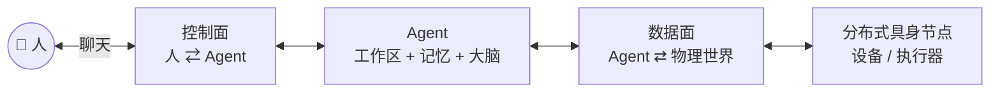

# Agent-Ops-Architecture

**分布式 Agent 编排规范：跨越数字与物理边界 —— 一个人，指挥一支 AI 团队，驱动无数物理节点。**

🔗 **三件套** · [🔭 总蓝图（本仓）](https://github.com/Ly-Systems-Lab/Agent-Ops-Architecture) · [🧠 控制面 · WeCom-Bridge](https://github.com/Ly-Systems-Lab/Agent-Ops-WeCom-Bridge) · [🔌 数据面 · Edge-Hub](https://github.com/Ly-Systems-Lab/Agent-Ops-Edge-Hub)

> 这是 **Agent Ops 三件套**里的「总蓝图」—— **只有文档，没有代码**。
>
> 它回答两个正在合并的问题：**当 AI 开始需要一具身体，这具身体该怎么接？**
> **当一个人手上有一支 Agent 团队和一堆设备，谁说了算、怎么留痕？**
>
> 我们的答案不是"把模型塞进设备"，而是**把大脑和躯体拆开** ——
> 云端负责想，边缘负责调度，端侧负责动，中间由一条**窄而确定**的通道连起来；
> 而且这条通道断了，躯体要能自己活着。
>
> **数字世界那一半不需要身体** —— 只想要「手机指挥电脑」的人，用控制面就够。

[English summary →](README.en.md)

---

## 🎬 演示

| 看什么 | 视频 |
|---|---|
| **数据面** · 一句话驱动三台端侧设备（含具身智能小车）依次动作 —— 36 秒 | [▶ 观看](https://www.bilibili.com/video/BV18Zx86KEDT/) |
| **控制面** · 手机上发指令，结果落在 Windows 本地；任务卡片（允许 / 拒绝 / 实时进度 / 上下文余量）与 `/stop` 即刻停止 | [▶ 观看](https://www.bilibili.com/video/BV1nY4w6kEiy) |

🖼️ **实拍图集** · [多设备控制回显 / Windows 本地工作 / 端侧预警推送 →](docs/showcase/README.md)

---

## 三件套

| 仓库 | 面 | 一句话 | 状态 |
|---|---|---|---|
| **本仓** · [`Agent-Ops-Architecture`](https://github.com/Ly-Systems-Lab/Agent-Ops-Architecture) | **总蓝图** | 分布式 Agent 编排规范：跨越数字与物理边界；《协同宣言》与人机协同约定 | 已公开 |
| [`Agent-Ops-WeCom-Bridge`](https://github.com/Ly-Systems-Lab/Agent-Ops-WeCom-Bridge) | **控制面** · 人 ⇄ Agent | 把企业微信变成 Agent 的调度台：流式交互、进度管控、权限拦截 | 已公开 |
| [`Agent-Ops-Edge-Hub`](https://github.com/Ly-Systems-Lab/Agent-Ops-Edge-Hub) | **数据面** · Agent ⇄ 物理世界 | 基于 MQTT 的边缘通信底座：把 Agent 的意图转成设备的真实动作 | 已公开 |

**控制面与数据面彻底解耦** —— 两个仓之间不互相调用，只共享同一套约定
（同一个 Agent 概念、同一个路由原则、同一条留痕要求）。

---

## 它解决了什么问题

三件套**可以单独用，也可以合起来用** —— 因为痛点不在同一个地方。

| 面 | 替谁解决什么 | 没有它的时候 |
|---|---|---|
| **控制面** · 人 ⇄ Agent | 你已经在自己的电脑上跑通了 Claude Code / Codex（**Windows 与 Linux 树莓派都是已跑通的闭环**；直连、或经 API 中转），但**人一离开，能力就锁在那台机器前**；想在手机上用，官方 App 在部分网络与账号环境里并不好使。控制面把企微变成它的手机窗口：**机器能用，手机就能用** —— 不动你的模型配置，也不要公网 IP、不要专用服务器。 | 守在电脑前；或者用远程桌面 / 手机终端盯着一个黑框 —— 看不到第几步、看不到改了哪个文件、危险动作拦不住 |
| **数据面** · Agent ⇄ 物理世界 | Agent 想要一双手：面板、小车、传感器。数据面把「意图」变成**有回执的动作**：每台设备独立凭据、按主题收窄授权、幂等 + 冷却 + 超时；主服务器挂了，设备**降级不自毁**。 | 把模型塞进每台设备（算力不够、断网发呆）；或者一堆各自为政的 App —— 没有一个地方能同时看见、指挥它们 |
| **两者结合** | 手机上一句话 → Agent 在数字世界里干活**和**在物理世界里动作 → 回执落回**同一个聊天窗口**。一条留痕贯穿到底：谁 `@` 的、跑了什么、设备动没动。 | 数字侧和物理侧是两座孤岛：聊天能指挥 Agent，Agent 指挥不了设备；设备有 App，Agent 进不去 |

**为什么能分开用：**

- 📱 纯数字玩家：只要「手机指挥电脑」→ 只装**控制面**，一台设备都不用接。
- 🤖 物理极客：只要「Agent 指挥设备」→ 只装**数据面**，不用企微 —— 任何持有独立凭据的 MQTT 接入方都能当指令源。
- 🌐 全栈大佬：两个都要 → 它们之间**不互相调用**，只共享同一套约定。

> 关于门槛：官方客户端在国内网络下的可用性，是能力之外的问题 —— **我们不去碰它**。
> 控制面不自建模型客户端，只是把你电脑上已经在用的那个接进聊天入口（相当于官方帮你做了内网穿透）。
> 对已经通过 API 中转在自己电脑上用上模型的人，这一点尤其直接：**电脑上能跑，手机上就能用。**

> **它是最小闭环，不是终点。** 手机远程控制 **Windows 与 Linux（树莓派）** 都已跑通 ——
> 连开机自启都是（Linux 用的是它自己的服务管理，不是我们的 Windows 脚本）。
> **推荐让 Agent 陪你一起读、一起搭**：把这份约定交给它，让它照着你的平台补上自启、单实例、进程树那几处，
> 再按你的需求继续扩展。**这正是《协同宣言》的意思 —— 人负责意图与底线，Agent 负责检索与执行。**
> **全量开源的意义也在这里**：你不需要一个万能产品，你需要一个能照着自己需求长出来的起点。

---

## 六十秒版本

1. 💬 **入口是聊天。** 你在哪，工作台就在哪 —— 不需要公网 IP，不需要一台专用服务器。
2. 🎯 **人是唯一的调度者。** Agent 之间不直接通信，`@` 只由人发出 —— 防打架、防串通、可归责。
3. 🧠 **一个 Agent = 工作区 + 记忆 + 大脑。** 换个窗口进来，还是同一个 Agent。
4. 🧩 **大脑与躯体解耦。** 中间隔一层适配器：报文有上限、指令幂等、动作冷却、回执超时。
5. 🛡️ **优雅降级是底线。** 主服务器挂了，设备不变砖 —— 从"全局智能"降到"局部自治"。
6. 🧾 **每个动作留痕。** 谁点的、跑了什么、结果如何，都看得见。

> 🎬 第 5 条的实拍 —— **[熔断探测 → 降级直连 → 自恢复（C3 无感）](https://www.bilibili.com/video/BV1UDh169E3s)**

---

## 文档

建议按顺序读 —— 五篇是一条线：**问题 → 信念 → 愿景 → 结构 → 判据。**

| 顺序 | 想了解什么 | 读这篇 |
|---|---|---|
| 1 | 这东西解决什么时代痛点 | [**为什么做这个生态**](docs/why.md) |
| 2 | 我们相信什么、拒绝什么 | [**《协同宣言》**](docs/manifesto.md) |
| 3 | 我们要定义的那个未来 | [**跨越数字与物理边界**](docs/embodied-ai.md) |
| 4 | 全景架构长什么样 | [**全景架构**](docs/architecture.md) |
| 5 | 想照抄一套能用的规矩 | [**五条协同约定**](docs/conventions.md) |

> 📄 **已经有人照着接过了**：[外部接入记录 →](https://github.com/Ly-Systems-Lab/Agent-Ops-WeCom-Bridge/blob/main/docs/field-reports/README.md)
> —— OpenCode 与 Codex 两个 Agent 互不知情，各自只拿同一份文档从零接入，
> 却把同一套「6 个运行器适配点」填成了各自的答案。**「约定是通用的」不是我们说的，是它们自己撞出来的。**

---

## 许可

本仓架构规范与文档采用 **[CC BY 4.0](LICENSE)** 协议开源。
我们鼓励任何个人或企业基于本蓝图进行二次开发与商业落地，**唯一的期望是保留 Agent-Ops-Architecture · Ly-Systems-Lab 的署名。**

开源不仅是给人看，更是给 AI 学习。让 AI 成为你的分身，让万物成为 AI 的躯体。

---

> 献给所有敢于在 AI 时代重构自身工作流的探索者。