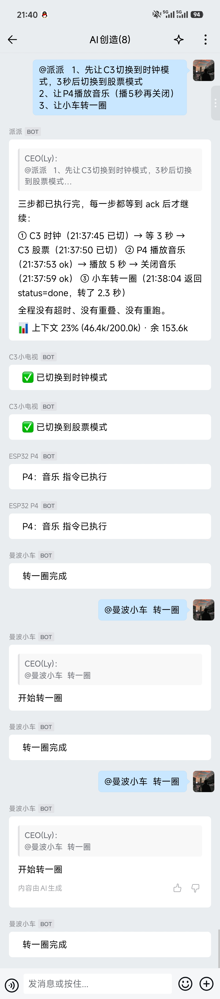
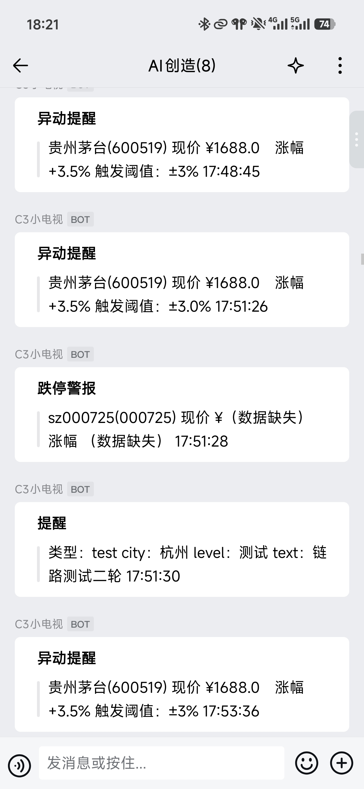

# 实拍展示

都是真机截图。**03 里的股票 / 天气为测试数据**（未开盘时做的链路验证）。

---

## 01 ｜ 手机上一句话，三台端侧设备依次响应

一条自然语言指令 → C3 小电视切模式 → P4 播放音乐 → 具身智能小车转一圈，
每一步都等到回执才继续，全程无超时、无重叠、无重跑。

---

## 02 ｜ 手机发指令 → Windows 本地干活

`@CC` 下达任务，结果落在本地磁盘；过程中三个工具调用各自先过「允许 / 拒绝」，
Agent 还自己发现并修复了审批 hook 的一个编码 Bug；
中途 `@DeepSeek` 解释了其中一个术语 —— 干活的和答疑的分开，各自只做自己的事。

---

## 03 ｜ 树莓派侧推送预警

树莓派（本地服务器端）主动推送到群里：股票异动 / 跌停 / 通用提醒。
股票与天气正文均为**测试数据**，用于验证链路；换任何一个数据源同理。

